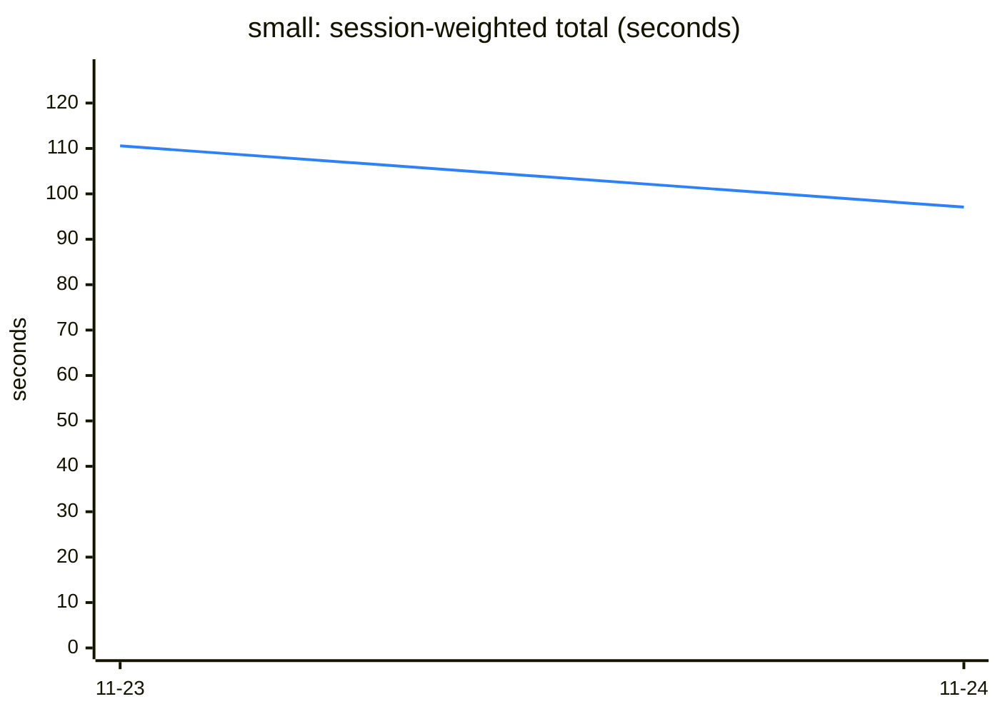
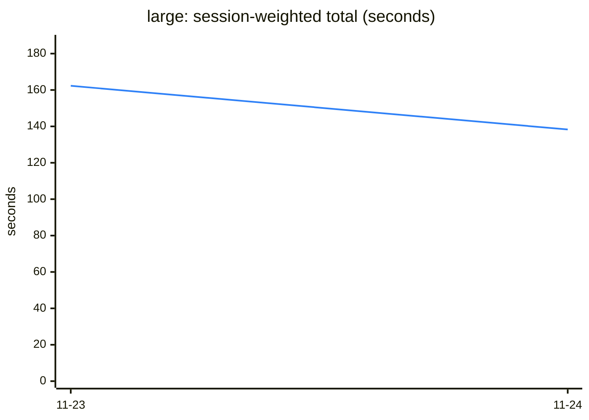
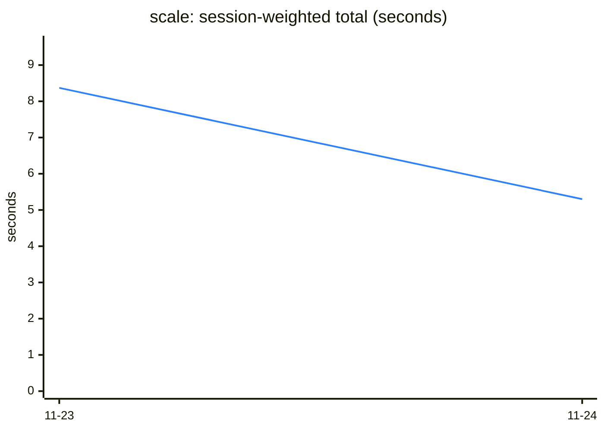
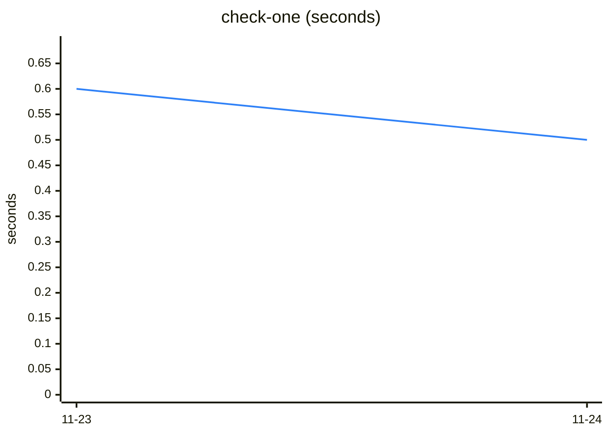
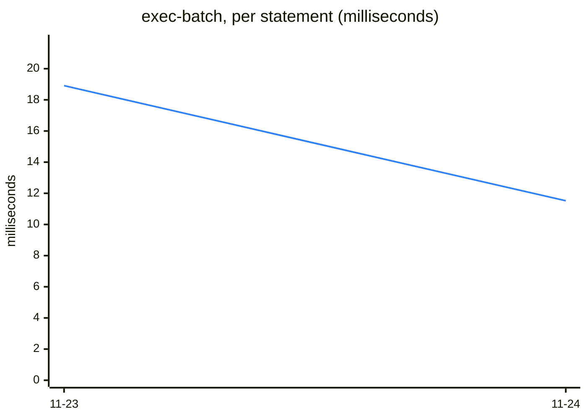
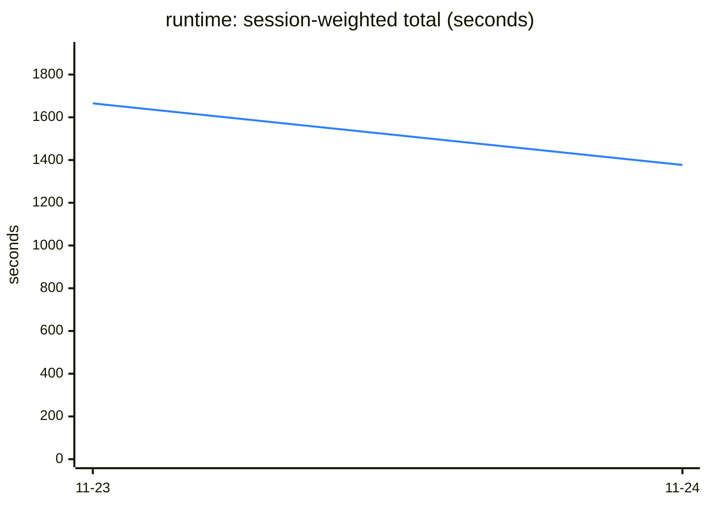

# Agent dev-loop benchmark — trend

2 runs, 2026-11-23 to 2026-11-24. Latest: `mxcli version 997c721 (2026-11-24T12:02:36Z)` against `mxcli version nightly-20261123-a3fb30ffd (2026-11-23T11:15:41Z)`.

Generated by `scripts/agentbench/trend` after each run; do not edit. Times are the candidate's median wall time on that night's runner, so two nights differ by the machine as well as by the code: read a level that stays, not one night's step. How to read it: `docs-site/src/internals/agent-benchmark.md` on `main`.

## Alerts

- **counts-increased**, runtime session, step `apply-entity`: units read from a file or the unit store: 108, the baseline 107

## small project — 370 units

| step | latest | run before | median of the 7 before | against that median | against its baseline, latest | last runs |
|---|---:|---:|---:|---:|---:|---|
| (session-weighted total) | 97.1 s | 110.6 s | 110.6 s | × 0.88 | × 1.00 | █▁ |
| open-cold | 179 ms | 197 ms | 197 ms | × 0.91 | × 1.05 | █▁ |
| open | 55 ms | 55 ms | 55 ms | × 1.00 | × 0.96 | █▁ |
| domain | 599 ms | 722 ms | 722 ms | × 0.83 | × 0.96 | █▁ |
| microflows | 495 ms | 995 ms | 995 ms | × 0.50 | × 0.96 | █▁ |
| pages | 1.47 s | 2.17 s | 2.17 s | × 0.68 | × 0.98 | █▁ |
| describe | 117 ms | 129 ms | 129 ms | × 0.91 | × 0.99 | █▁ |
| catalog | 184 ms | 227 ms | 227 ms | × 0.81 | × 0.98 | █▁ |
| catalog-full | 920 ms | 1.09 s | 1.09 s | × 0.84 | × 1.00 | █▁ |
| query | 73 ms | 83 ms | 83 ms | × 0.88 | × 0.99 | █▁ |
| check | 308 ms | 352 ms | 352 ms | × 0.88 | × 1.00 | █▁ |
| single-edit | 325 ms | 363 ms | 363 ms | × 0.90 | × 1.01 | █▁ |
| catalog-after-edit | 211 ms | 277 ms | 277 ms | × 0.76 | × 1.01 | █▁ |
| bulk-alter | 1.12 s | 1.40 s | 1.40 s | × 0.80 | × 0.98 | █▁ |
| re-exec | 523 ms | 600 ms | 600 ms | × 0.87 | × 0.98 | █▁ |
| rename | 419 ms | 682 ms | 682 ms | × 0.61 | × 0.99 | █▁ |

## large project — 910 units

| step | latest | run before | median of the 7 before | against that median | against its baseline, latest | last runs |
|---|---:|---:|---:|---:|---:|---|
| (session-weighted total) | 138.3 s | 162.3 s | 162.3 s | × 0.85 | × 0.99 | █▁ |
| open-cold | 322 ms | 369 ms | 369 ms | × 0.87 | × 1.02 | █▁ |
| open | 63 ms | 67 ms | 67 ms | × 0.94 | × 1.00 | █▁ |
| domain | 746 ms | 865 ms | 865 ms | × 0.86 | × 0.99 | █▁ |
| microflows | 1.14 s | 1.42 s | 1.42 s | × 0.81 | × 0.99 | █▁ |
| pages | 1.84 s | 2.54 s | 2.54 s | × 0.72 | × 0.96 | █▁ |
| describe | 134 ms | 153 ms | 153 ms | × 0.88 | × 0.97 | █▁ |
| catalog | 285 ms | 388 ms | 388 ms | × 0.73 | × 0.99 | █▁ |
| catalog-full | 2.85 s | 3.46 s | 3.46 s | × 0.82 | × 0.98 | █▁ |
| query | 77 ms | 85 ms | 85 ms | × 0.90 | × 1.01 | █▁ |
| check | 463 ms | 536 ms | 536 ms | × 0.86 | × 1.01 | █▁ |
| single-edit | 459 ms | 542 ms | 542 ms | × 0.85 | × 0.99 | █▁ |
| catalog-after-edit | 317 ms | 378 ms | 378 ms | × 0.84 | × 1.00 | █▁ |
| bulk-alter | 1.34 s | 1.59 s | 1.59 s | × 0.84 | × 0.99 | █▁ |
| re-exec | 730 ms | 849 ms | 849 ms | × 0.86 | × 0.99 | █▁ |
| rename | 796 ms | 994 ms | 994 ms | × 0.80 | × 1.00 | █▁ |

## scale project — 4374 units

| step | latest | run before | median of the 7 before | against that median | against its baseline, latest | last runs |
|---|---:|---:|---:|---:|---:|---|
| (session-weighted total) | 5.30 s | 8.37 s | 8.37 s | × 0.63 | × 1.00 | █▁ |
| check-cold | 1.46 s | 2.04 s | 2.04 s | × 0.72 | × 1.02 | █▁ |
| check-one | 498 ms | 598 ms | 598 ms | × 0.83 | × 1.00 | █▁ |
| check-batch | 864 ms | 1.09 s | 1.09 s | × 0.79 | × 0.96 | █▁ |
| exec-batch | 1.15 s | 1.89 s | 1.89 s | × 0.61 | × 0.98 | █▁ |
| re-exec-batch | 545 ms | 706 ms | 706 ms | × 0.77 | × 0.97 | █▁ |
| new-batch | 777 ms | 2.04 s | 2.04 s | × 0.38 | × 1.00 | █▁ |

## running app — 476 units

| step | latest | run before | median of the 7 before | against that median | against its baseline, latest | last runs |
|---|---:|---:|---:|---:|---:|---|
| (session-weighted total) | 1376.9 s | 1665.1 s | 1665.1 s | × 0.83 | × 0.97 | █▁ |
| mx-check | 4.61 s | 6.33 s | 6.33 s | × 0.73 | × 0.94 | █▁ |
| build | 43.9 s | 51.2 s | 51.2 s | × 0.86 | × 0.99 | █▁ |
| boot | 20.3 s | 24.3 s | 24.3 s | × 0.84 | × 1.04 | █▁ |
| page-check | 2.49 s | 2.93 s | 2.93 s | × 0.85 | × 1.01 | █▁ |
| hot-apply | 4.35 s | 4.68 s | 4.68 s | × 0.93 | × 0.95 | █▁ |
| test-attach | 104 ms | 118 ms | 118 ms | × 0.88 | × 0.93 | █▁ |
| apply-entity | 14.1 s | 16.4 s | 16.4 s | × 0.86 | × 1.02 | █▁ |
| stop | 730 ms | 734 ms | 734 ms | × 0.99 | × 1.00 | █▁ |
| test-cold | 18.0 s | 21.2 s | 21.2 s | × 0.85 | × 1.01 | █▁ |
