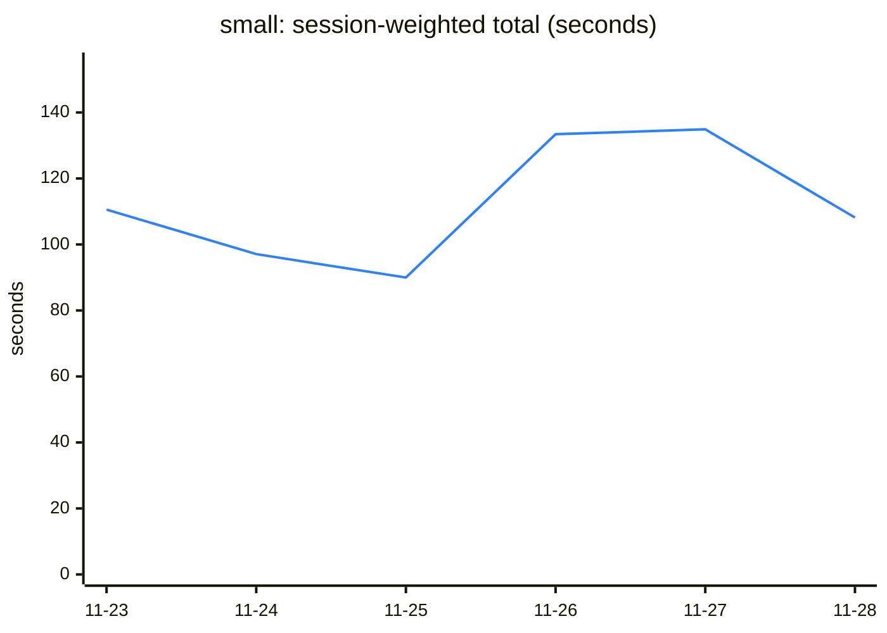
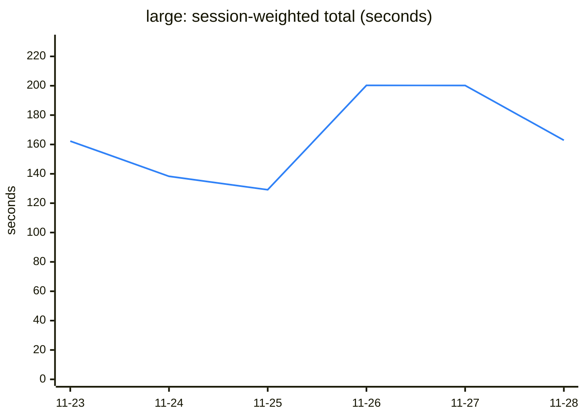
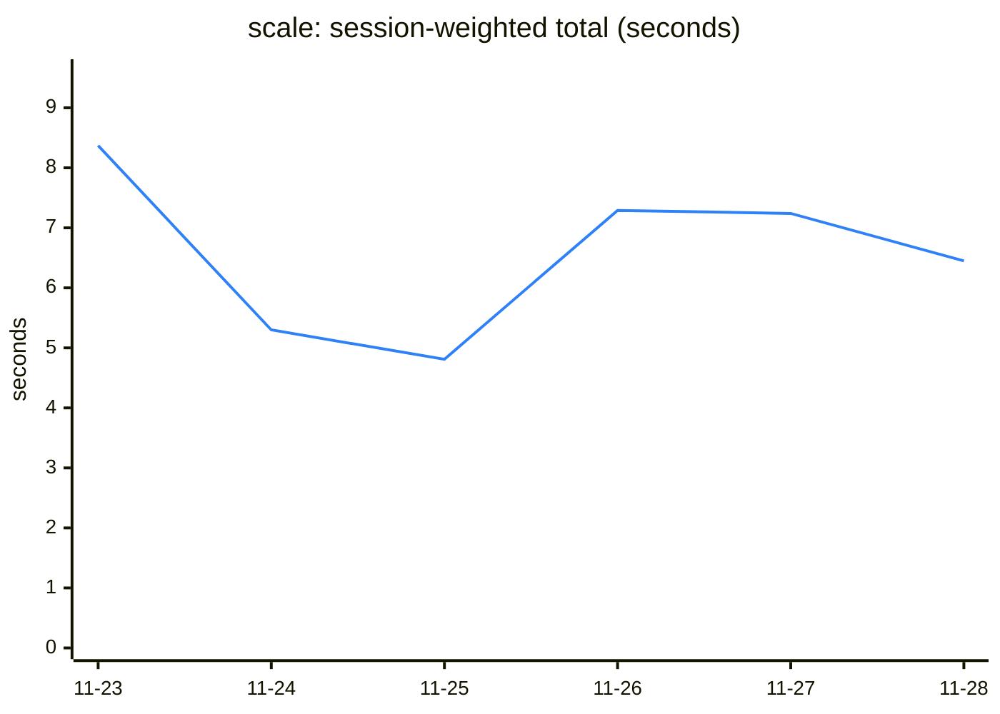
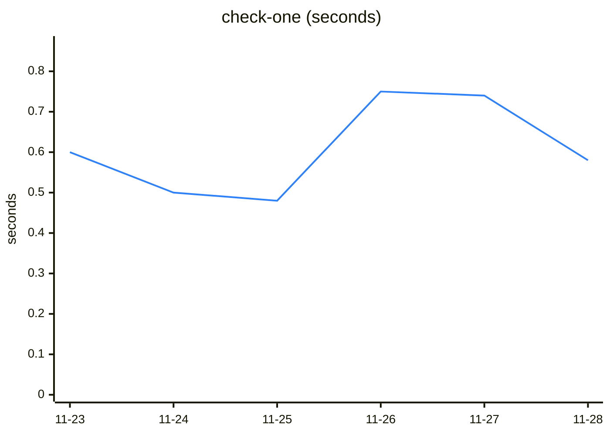
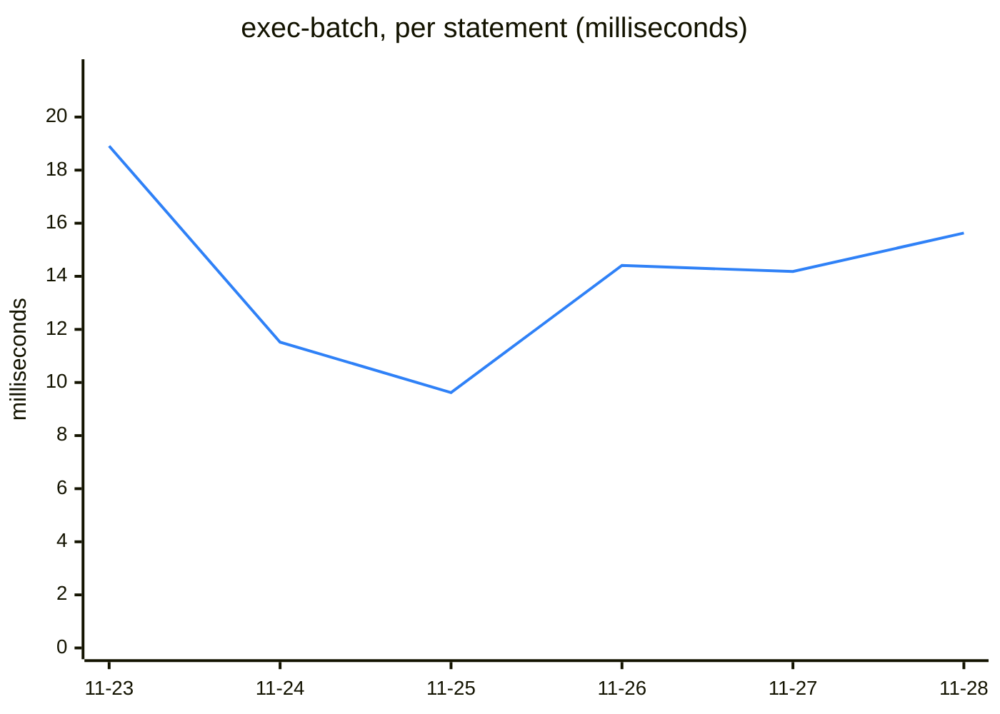
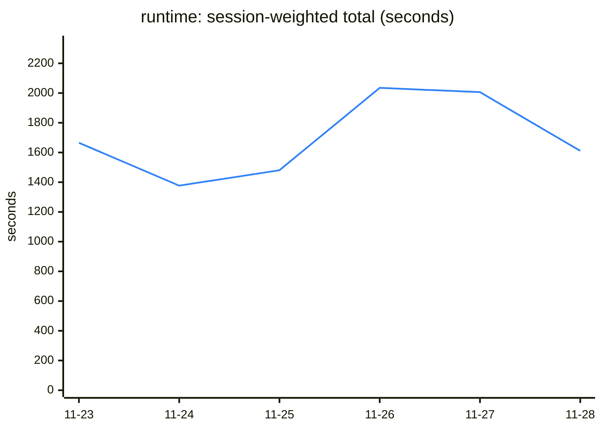

# Agent dev-loop benchmark — trend

6 runs, 2026-11-23 to 2026-11-28. Latest: `mxcli version 997c721 (2026-11-28T09:50:45Z)` against `mxcli version nightly-20261124-997c721f6 (2026-11-24T12:56:37Z)`.

Generated by `scripts/agentbench/trend` after each run; do not edit. Times are the candidate's median wall time on that night's runner, so two nights differ by the machine as well as by the code: read a level that stays, not one night's step. How to read it: `docs-site/src/internals/agent-benchmark.md` on `main`.

## Alerts

None.

## small project — 370 units

| step | latest | run before | median of the 7 before | against that median | against its baseline, latest | last runs |
|---|---:|---:|---:|---:|---:|---|
| (session-weighted total) | 108.2 s | 134.9 s | 110.6 s | × 0.98 | × 0.96 | ▄▂▁██▄ |
| open-cold | 225 ms | 194 ms | 189 ms | × 1.19 | × 1.01 | ▆▄▁▅▆█ |
| open | 56 ms | 71 ms | 55 ms | × 1.01 | × 0.97 | ▄▄▁██▄ |
| domain | 700 ms | 914 ms | 722 ms | × 0.97 | × 0.99 | ▄▁▁██▃ |
| microflows | 725 ms | 676 ms | 654 ms | × 1.11 | × 1.14 | █▂▁▄▄▅ |
| pages | 2.01 s | 2.09 s | 2.07 s | × 0.97 | × 0.93 | █▁▁▇█▇ |
| describe | 128 ms | 163 ms | 129 ms | × 0.99 | × 0.99 | ▄▂▁██▄ |
| catalog | 220 ms | 293 ms | 227 ms | × 0.97 | × 0.92 | ▄▁▁██▄ |
| catalog-full | 1.08 s | 1.45 s | 1.09 s | × 0.99 | × 0.96 | ▃▁▁██▃ |
| query | 80 ms | 100 ms | 83 ms | × 0.97 | × 1.02 | ▅▃▁▇█▄ |
| check | 336 ms | 433 ms | 352 ms | × 0.96 | × 0.98 | ▄▁▁██▃ |
| single-edit | 360 ms | 449 ms | 363 ms | × 0.99 | × 0.94 | ▄▂▁██▄ |
| catalog-after-edit | 237 ms | 282 ms | 277 ms | × 0.86 | × 0.98 | █▃▁██▅ |
| bulk-alter | 1.98 s | 1.46 s | 1.40 s | × 1.42 | × 0.96 | ▄▂▁▄▄█ |
| re-exec | 589 ms | 752 ms | 600 ms | × 0.98 | × 0.99 | ▃▁▁██▃ |
| rename | 501 ms | 639 ms | 639 ms | × 0.78 | × 0.90 | █▁▁▇▇▃ |

## large project — 910 units

| step | latest | run before | median of the 7 before | against that median | against its baseline, latest | last runs |
|---|---:|---:|---:|---:|---:|---|
| (session-weighted total) | 162.9 s | 200.2 s | 162.3 s | × 1.00 | × 0.99 | ▄▂▁██▄ |
| open-cold | 386 ms | 360 ms | 360 ms | × 1.07 | × 1.12 | ▇▅▁▇▇█ |
| open | 70 ms | 88 ms | 67 ms | × 1.04 | × 1.01 | ▃▂▁██▄ |
| domain | 841 ms | 1.07 s | 865 ms | × 0.97 | × 1.00 | ▄▁▁██▃ |
| microflows | 1.60 s | 1.66 s | 1.42 s | × 1.13 | × 1.07 | ▆▃▁███ |
| pages | 2.37 s | 2.55 s | 2.54 s | × 0.93 | × 0.89 | █▂▁██▇ |
| describe | 150 ms | 195 ms | 153 ms | × 0.98 | × 0.97 | ▄▂▁██▃ |
| catalog | 347 ms | 438 ms | 388 ms | × 0.89 | × 0.97 | ▆▂▁██▄ |
| catalog-full | 3.37 s | 4.53 s | 3.46 s | × 0.97 | × 1.01 | ▃▁▁██▃ |
| query | 80 ms | 102 ms | 85 ms | × 0.94 | × 0.98 | ▅▃▁▇█▃ |
| check | 530 ms | 671 ms | 536 ms | × 0.99 | × 0.98 | ▄▁▁██▄ |
| single-edit | 552 ms | 668 ms | 542 ms | × 1.02 | × 1.00 | ▄▁▁██▅ |
| catalog-after-edit | 369 ms | 412 ms | 378 ms | × 0.98 | × 0.97 | ▇▃▁██▆ |
| bulk-alter | 1.76 s | 1.81 s | 1.59 s | × 1.11 | × 1.05 | ▆▂▁███ |
| re-exec | 840 ms | 1.06 s | 849 ms | × 0.99 | × 1.01 | ▄▁▁██▄ |
| rename | 992 ms | 1.27 s | 994 ms | × 1.00 | × 1.00 | ▄▁▁██▄ |

## scale project — 4374 units

| step | latest | run before | median of the 7 before | against that median | against its baseline, latest | last runs |
|---|---:|---:|---:|---:|---:|---|
| (session-weighted total) | 6.45 s | 7.24 s | 7.24 s | × 0.89 | × 1.00 | █▂▁▆▆▄ |
| check-cold | 1.75 s | 2.00 s | 1.97 s | × 0.89 | × 1.00 | █▂▁██▅ |
| check-one | 582 ms | 740 ms | 598 ms | × 0.97 | × 1.01 | ▄▁▁██▃ |
| check-batch | 1.02 s | 1.33 s | 1.09 s | × 0.93 | × 0.99 | ▄▁▁██▃ |
| exec-batch | 1.56 s | 1.42 s | 1.42 s | × 1.10 | × 0.90 | █▂▁▅▄▆ |
| re-exec-batch | 632 ms | 770 ms | 706 ms | × 0.89 | × 0.99 | ▆▁▁██▄ |
| new-batch | 913 ms | 977 ms | 977 ms | × 0.93 | × 1.05 | █▁▁▃▃▂ |

## running app — 476 units

| step | latest | run before | median of the 7 before | against that median | against its baseline, latest | last runs |
|---|---:|---:|---:|---:|---:|---|
| (session-weighted total) | 1611.1 s | 2006.0 s | 1665.1 s | × 0.97 | × 0.99 | ▄▁▂██▃ |
| mx-check | 6.01 s | 8.44 s | 6.33 s | × 0.95 | × 1.02 | ▄▁▃██▃ |
| build | 51.1 s | 58.0 s | 51.2 s | × 1.00 | × 1.00 | ▅▁▁██▅ |
| boot | 23.8 s | 28.9 s | 24.3 s | × 0.98 | × 0.96 | ▄▁▂█▇▃ |
| page-check | 2.68 s | 3.27 s | 2.93 s | × 0.92 | × 0.94 | ▅▁▁██▃ |
| hot-apply | 4.71 s | 5.39 s | 4.68 s | × 1.01 | × 0.99 | ▃▁▁██▃ |
| test-attach | 114 ms | 140 ms | 118 ms | × 0.97 | × 1.01 | ▄▁▁██▃ |
| apply-entity | 15.7 s | 18.4 s | 16.4 s | × 0.96 | × 1.00 | ▅▁▁██▃ |
| stop | 837 ms | 842 ms | 734 ms | × 1.14 | × 1.00 | ▄▄▁███ |
| test-cold | 20.3 s | 24.7 s | 21.2 s | × 0.95 | × 0.94 | ▄▁▁██▃ |
