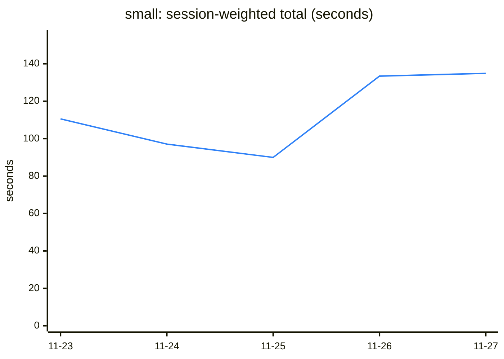
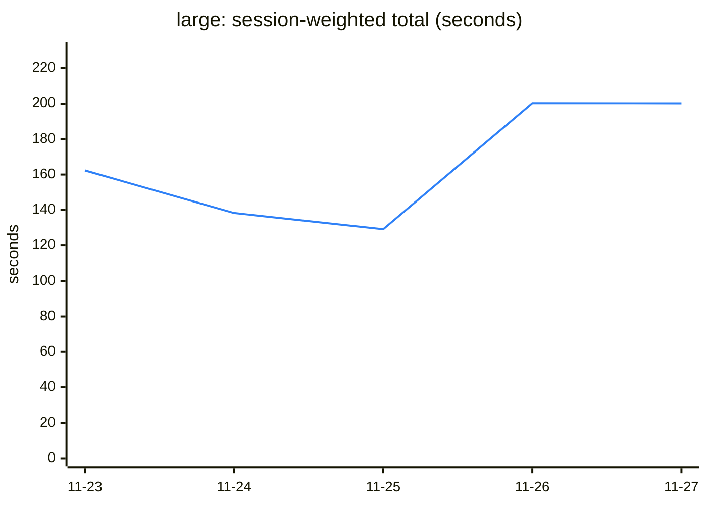
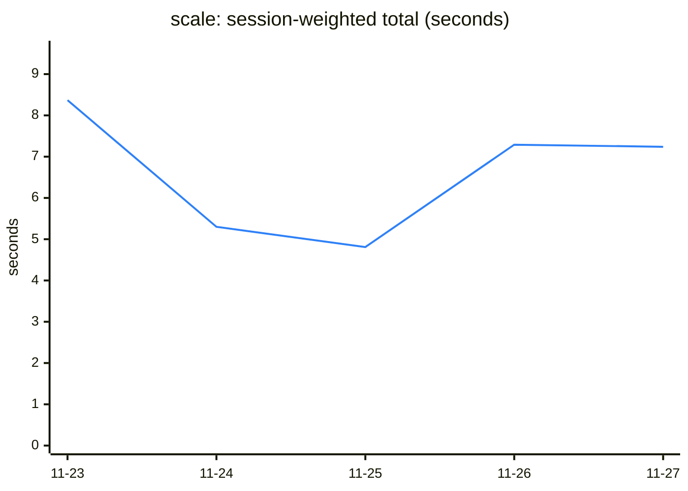
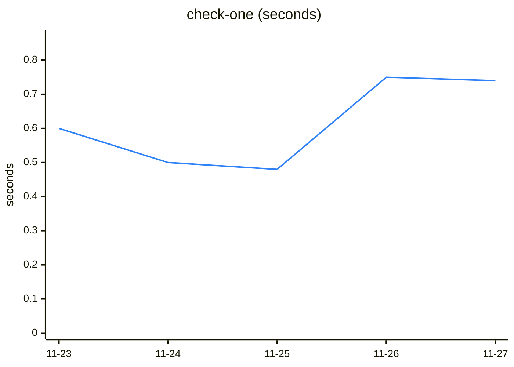
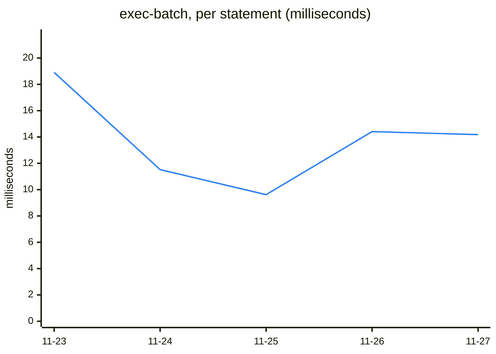
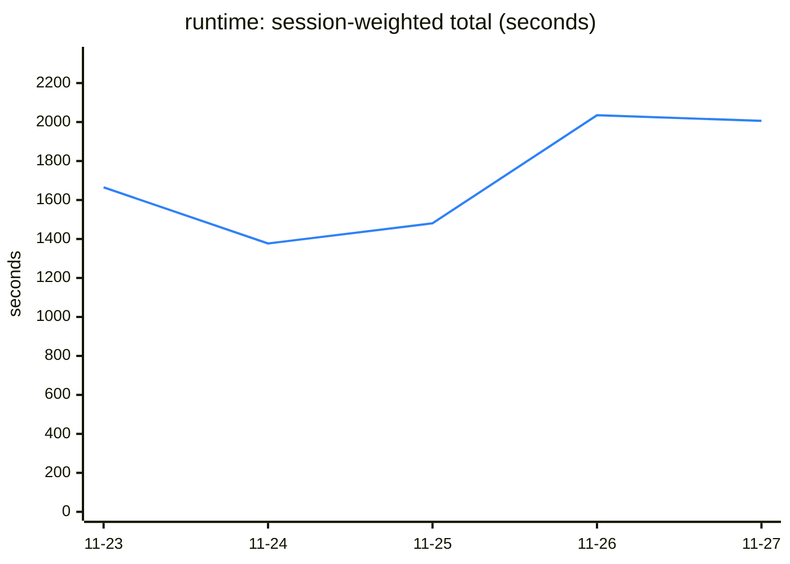

# Agent dev-loop benchmark — trend

5 runs, 2026-11-23 to 2026-11-27. Latest: `mxcli version 997c721 (2026-11-27T10:34:27Z)` against `mxcli version nightly-20261124-997c721f6 (2026-11-24T12:56:37Z)`.

Generated by `scripts/agentbench/trend` after each run; do not edit. Times are the candidate's median wall time on that night's runner, so two nights differ by the machine as well as by the code: read a level that stays, not one night's step. How to read it: `docs-site/src/internals/agent-benchmark.md` on `main`.

## Alerts

None.

## small project — 370 units

| step | latest | run before | median of the 7 before | against that median | against its baseline, latest | last runs |
|---|---:|---:|---:|---:|---:|---|
| (session-weighted total) | 134.9 s | 133.4 s | 103.8 s | × 1.30 | × 0.99 | ▄▂▁██ |
| open-cold | 194 ms | 189 ms | 184 ms | × 1.06 | × 1.01 | █▆▁▇█ |
| open | 71 ms | 69 ms | 55 ms | × 1.29 | × 1.04 | ▄▄▁██ |
| domain | 914 ms | 915 ms | 666 ms | × 1.37 | × 1.01 | ▄▁▁██ |
| microflows | 676 ms | 654 ms | 575 ms | × 1.18 | × 0.99 | █▂▁▄▄ |
| pages | 2.09 s | 2.07 s | 1.77 s | × 1.18 | × 0.99 | █▁▁▇█ |
| describe | 163 ms | 157 ms | 123 ms | × 1.32 | × 1.03 | ▄▂▁██ |
| catalog | 293 ms | 287 ms | 206 ms | × 1.43 | × 1.01 | ▄▁▁██ |
| catalog-full | 1.45 s | 1.45 s | 1.01 s | × 1.44 | × 1.00 | ▃▁▁██ |
| query | 100 ms | 96 ms | 78 ms | × 1.29 | × 0.98 | ▅▃▁▇█ |
| check | 433 ms | 428 ms | 330 ms | × 1.31 | × 0.99 | ▄▁▁██ |
| single-edit | 449 ms | 447 ms | 344 ms | × 1.31 | × 0.98 | ▄▂▁██ |
| catalog-after-edit | 282 ms | 281 ms | 244 ms | × 1.16 | × 1.00 | █▃▁██ |
| bulk-alter | 1.46 s | 1.43 s | 1.26 s | × 1.16 | × 1.00 | ▇▃▁██ |
| re-exec | 752 ms | 745 ms | 562 ms | × 1.34 | × 1.01 | ▃▁▁██ |
| rename | 639 ms | 646 ms | 536 ms | × 1.19 | × 0.98 | █▁▁▇▇ |

## large project — 910 units

| step | latest | run before | median of the 7 before | against that median | against its baseline, latest | last runs |
|---|---:|---:|---:|---:|---:|---|
| (session-weighted total) | 200.2 s | 200.2 s | 150.3 s | × 1.33 | × 1.00 | ▄▂▁██ |
| open-cold | 360 ms | 362 ms | 342 ms | × 1.05 | × 1.01 | █▅▁██ |
| open | 88 ms | 85 ms | 65 ms | × 1.35 | × 0.96 | ▃▂▁██ |
| domain | 1.07 s | 1.05 s | 806 ms | × 1.33 | × 0.99 | ▄▁▁██ |
| microflows | 1.66 s | 1.64 s | 1.28 s | × 1.30 | × 1.01 | ▆▃▁██ |
| pages | 2.55 s | 2.57 s | 2.19 s | × 1.16 | × 0.98 | █▂▁██ |
| describe | 195 ms | 189 ms | 144 ms | × 1.36 | × 1.00 | ▄▂▁██ |
| catalog | 438 ms | 433 ms | 336 ms | × 1.30 | × 0.98 | ▆▂▁██ |
| catalog-full | 4.53 s | 4.60 s | 3.18 s | × 1.43 | × 1.00 | ▃▁▁██ |
| query | 102 ms | 98 ms | 81 ms | × 1.26 | × 1.03 | ▅▃▁▇█ |
| check | 671 ms | 669 ms | 499 ms | × 1.34 | × 1.01 | ▄▁▁██ |
| single-edit | 668 ms | 673 ms | 501 ms | × 1.33 | × 1.00 | ▄▁▁██ |
| catalog-after-edit | 412 ms | 413 ms | 348 ms | × 1.19 | × 1.00 | ▇▃▁██ |
| bulk-alter | 1.81 s | 1.77 s | 1.47 s | × 1.23 | × 1.00 | ▆▂▁██ |
| re-exec | 1.06 s | 1.05 s | 789 ms | × 1.34 | × 1.00 | ▄▁▁██ |
| rename | 1.27 s | 1.27 s | 903 ms | × 1.40 | × 1.00 | ▄▁▁██ |

## scale project — 4374 units

| step | latest | run before | median of the 7 before | against that median | against its baseline, latest | last runs |
|---|---:|---:|---:|---:|---:|---|
| (session-weighted total) | 7.24 s | 7.29 s | 6.29 s | × 1.15 | × 1.00 | █▂▁▆▆ |
| check-cold | 2.00 s | 1.97 s | 1.71 s | × 1.17 | × 0.97 | █▂▁██ |
| check-one | 740 ms | 754 ms | 548 ms | × 1.35 | × 0.99 | ▄▁▁██ |
| check-batch | 1.33 s | 1.36 s | 1000 ms | × 1.33 | × 0.99 | ▄▁▁██ |
| exec-batch | 1.42 s | 1.44 s | 1.30 s | × 1.09 | × 0.99 | █▂▁▅▄ |
| re-exec-batch | 770 ms | 780 ms | 626 ms | × 1.23 | × 1.00 | ▆▁▁██ |
| new-batch | 977 ms | 981 ms | 879 ms | × 1.11 | × 1.00 | █▁▁▃▃ |

## running app — 476 units

| step | latest | run before | median of the 7 before | against that median | against its baseline, latest | last runs |
|---|---:|---:|---:|---:|---:|---|
| (session-weighted total) | 2006.0 s | 2034.9 s | 1572.9 s | × 1.28 | × 1.00 | ▄▁▂██ |
| mx-check | 8.44 s | 8.53 s | 5.97 s | × 1.41 | × 1.02 | ▄▁▃██ |
| build | 58.0 s | 58.5 s | 47.6 s | × 1.22 | × 1.01 | ▅▁▁██ |
| boot | 28.9 s | 30.1 s | 23.3 s | × 1.24 | × 1.03 | ▄▁▂█▇ |
| page-check | 3.27 s | 3.29 s | 2.71 s | × 1.21 | × 1.00 | ▅▁▁██ |
| hot-apply | 5.39 s | 5.53 s | 4.52 s | × 1.19 | × 1.00 | ▃▁▁██ |
| test-attach | 140 ms | 137 ms | 111 ms | × 1.27 | × 0.96 | ▄▁▁██ |
| apply-entity | 18.4 s | 18.2 s | 15.3 s | × 1.20 | × 0.99 | ▅▁▁██ |
| stop | 842 ms | 842 ms | 732 ms | × 1.15 | × 1.00 | ▄▄▁██ |
| test-cold | 24.7 s | 25.4 s | 20.0 s | × 1.24 | × 0.98 | ▄▁▁██ |
