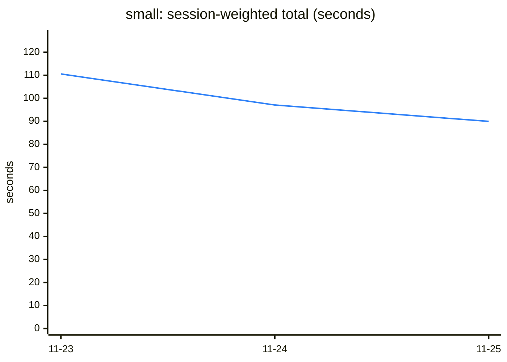
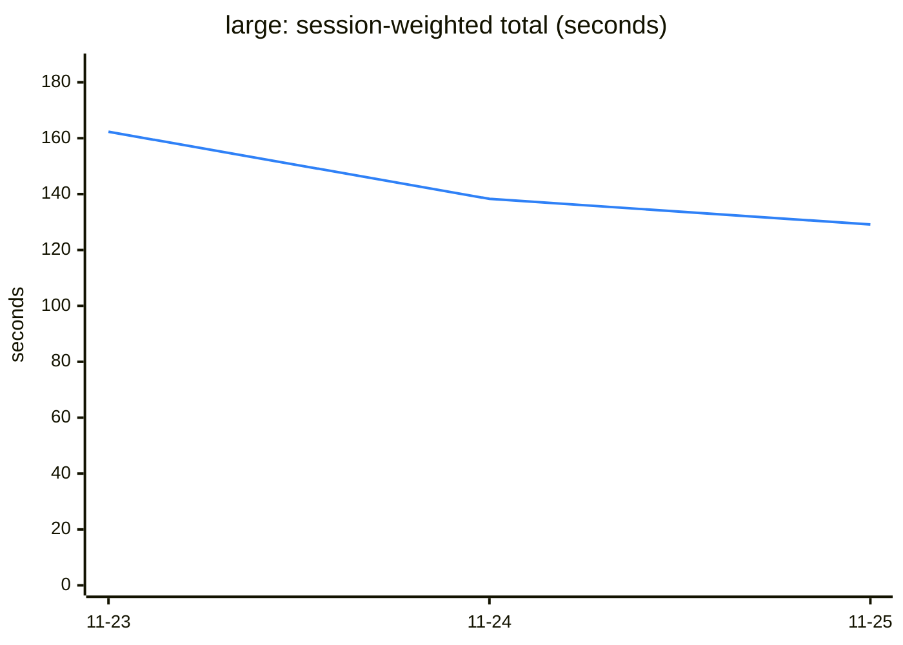
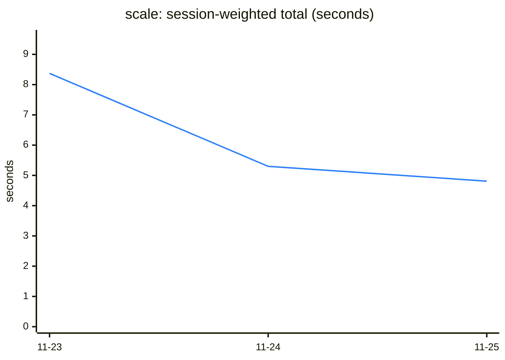
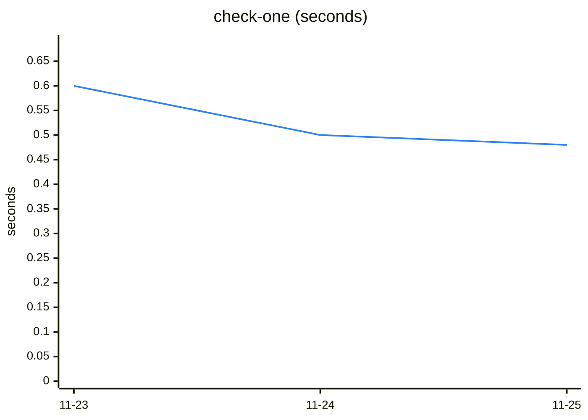
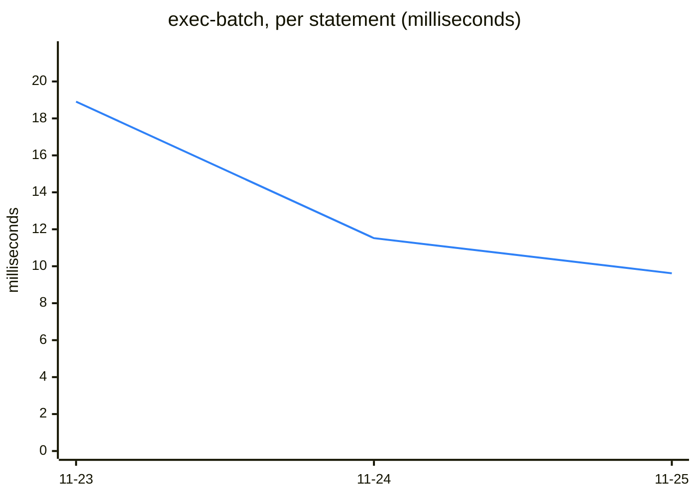
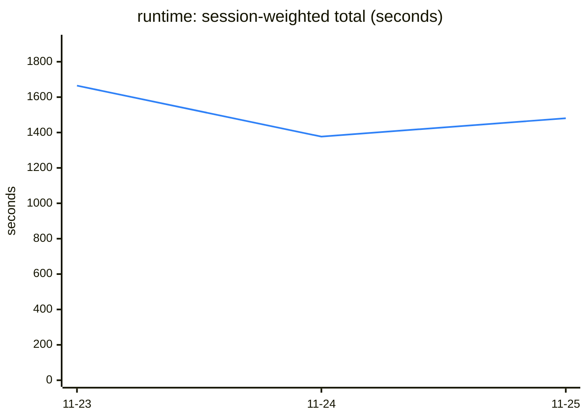

# Agent dev-loop benchmark — trend

3 runs, 2026-11-23 to 2026-11-25. Latest: `mxcli version 997c721 (2026-11-25T10:55:21Z)` against `mxcli version nightly-20261124-997c721f6 (2026-11-24T12:56:37Z)`.

Generated by `scripts/agentbench/trend` after each run; do not edit. Times are the candidate's median wall time on that night's runner, so two nights differ by the machine as well as by the code: read a level that stays, not one night's step. How to read it: `docs-site/src/internals/agent-benchmark.md` on `main`.

## Alerts

None.

## small project — 370 units

| step | latest | run before | median of the 7 before | against that median | against its baseline, latest | last runs |
|---|---:|---:|---:|---:|---:|---|
| (session-weighted total) | 90.0 s | 97.1 s | 103.8 s | × 0.87 | × 1.00 | █▃▁ |
| open-cold | 135 ms | 179 ms | 188 ms | × 0.72 | × 1.03 | █▆▁ |
| open | 43 ms | 55 ms | 55 ms | × 0.78 | × 0.97 | ██▁ |
| domain | 609 ms | 599 ms | 661 ms | × 0.92 | × 1.00 | █▁▁ |
| microflows | 419 ms | 495 ms | 745 ms | × 0.56 | × 1.01 | █▂▁ |
| pages | 1.43 s | 1.47 s | 1.82 s | × 0.78 | × 1.00 | █▁▁ |
| describe | 105 ms | 117 ms | 123 ms | × 0.85 | × 1.00 | █▅▁ |
| catalog | 172 ms | 184 ms | 206 ms | × 0.84 | × 1.00 | █▂▁ |
| catalog-full | 920 ms | 920 ms | 1.01 s | × 0.91 | × 1.00 | █▁▁ |
| query | 63 ms | 73 ms | 78 ms | × 0.81 | × 0.98 | █▅▁ |
| check | 296 ms | 308 ms | 330 ms | × 0.90 | × 1.02 | █▂▁ |
| single-edit | 301 ms | 325 ms | 344 ms | × 0.87 | × 0.99 | █▄▁ |
| catalog-after-edit | 176 ms | 211 ms | 244 ms | × 0.72 | × 1.01 | █▃▁ |
| bulk-alter | 978 ms | 1.12 s | 1.26 s | × 0.78 | × 0.99 | █▃▁ |
| re-exec | 521 ms | 523 ms | 562 ms | × 0.93 | × 1.01 | █▁▁ |
| rename | 426 ms | 419 ms | 551 ms | × 0.77 | × 1.01 | █▁▁ |

## large project — 910 units

| step | latest | run before | median of the 7 before | against that median | against its baseline, latest | last runs |
|---|---:|---:|---:|---:|---:|---|
| (session-weighted total) | 129.2 s | 138.3 s | 150.3 s | × 0.86 | × 1.00 | █▃▁ |
| open-cold | 256 ms | 322 ms | 346 ms | × 0.74 | × 1.00 | █▅▁ |
| open | 56 ms | 63 ms | 65 ms | × 0.86 | × 0.95 | █▆▁ |
| domain | 707 ms | 746 ms | 806 ms | × 0.88 | × 1.00 | █▂▁ |
| microflows | 928 ms | 1.14 s | 1.28 s | × 0.73 | × 1.00 | █▄▁ |
| pages | 1.70 s | 1.84 s | 2.19 s | × 0.78 | × 1.01 | █▂▁ |
| describe | 125 ms | 134 ms | 144 ms | × 0.87 | × 1.01 | █▃▁ |
| catalog | 260 ms | 285 ms | 336 ms | × 0.77 | × 1.01 | █▂▁ |
| catalog-full | 2.90 s | 2.85 s | 3.15 s | × 0.92 | × 0.99 | █▁▁ |
| query | 68 ms | 77 ms | 81 ms | × 0.84 | × 0.98 | █▅▁ |
| check | 437 ms | 463 ms | 499 ms | × 0.88 | × 1.00 | █▃▁ |
| single-edit | 430 ms | 459 ms | 501 ms | × 0.86 | × 0.99 | █▃▁ |
| catalog-after-edit | 262 ms | 317 ms | 348 ms | × 0.75 | × 1.01 | █▄▁ |
| bulk-alter | 1.19 s | 1.34 s | 1.47 s | × 0.81 | × 1.00 | █▄▁ |
| re-exec | 690 ms | 730 ms | 789 ms | × 0.87 | × 1.00 | █▃▁ |
| rename | 811 ms | 796 ms | 895 ms | × 0.91 | × 1.00 | █▁▁ |

## scale project — 4374 units

| step | latest | run before | median of the 7 before | against that median | against its baseline, latest | last runs |
|---|---:|---:|---:|---:|---:|---|
| (session-weighted total) | 4.81 s | 5.30 s | 6.83 s | × 0.70 | × 1.00 | █▂▁ |
| check-cold | 1.32 s | 1.46 s | 1.75 s | × 0.75 | × 1.00 | █▂▁ |
| check-one | 482 ms | 498 ms | 548 ms | × 0.88 | × 1.01 | █▂▁ |
| check-batch | 905 ms | 864 ms | 980 ms | × 0.92 | × 1.00 | █▁▂ |
| exec-batch | 962 ms | 1.15 s | 1.52 s | × 0.63 | × 1.00 | █▂▁ |
| re-exec-batch | 527 ms | 545 ms | 626 ms | × 0.84 | × 1.00 | █▁▁ |
| new-batch | 623 ms | 777 ms | 1.41 s | × 0.44 | × 1.00 | █▁▁ |

## running app — 476 units

| step | latest | run before | median of the 7 before | against that median | against its baseline, latest | last runs |
|---|---:|---:|---:|---:|---:|---|
| (session-weighted total) | 1480.6 s | 1376.9 s | 1521.0 s | × 0.97 | × 1.00 | █▁▃ |
| mx-check | 5.61 s | 4.61 s | 5.47 s | × 1.03 | × 1.01 | █▁▅ |
| build | 42.4 s | 43.9 s | 47.6 s | × 0.89 | × 1.00 | █▂▁ |
| boot | 22.3 s | 20.3 s | 22.3 s | × 1.00 | × 1.00 | █▁▄ |
| page-check | 2.46 s | 2.49 s | 2.71 s | × 0.91 | × 0.99 | █▁▁ |
| hot-apply | 4.36 s | 4.35 s | 4.52 s | × 0.96 | × 1.00 | █▁▁ |
| test-attach | 100 ms | 104 ms | 111 ms | × 0.91 | × 0.97 | █▂▁ |
| apply-entity | 14.3 s | 14.1 s | 15.2 s | × 0.94 | × 1.00 | █▁▁ |
| stop | 629 ms | 730 ms | 732 ms | × 0.86 | × 1.00 | ██▁ |
| test-cold | 18.7 s | 18.0 s | 19.6 s | × 0.95 | × 1.00 | █▁▂ |
