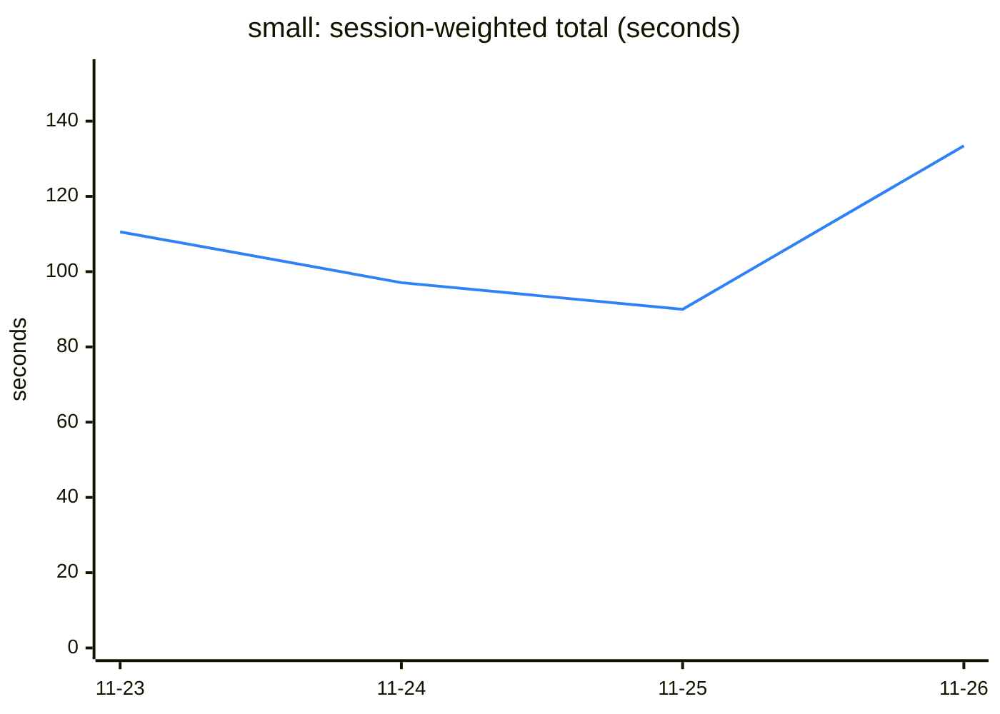
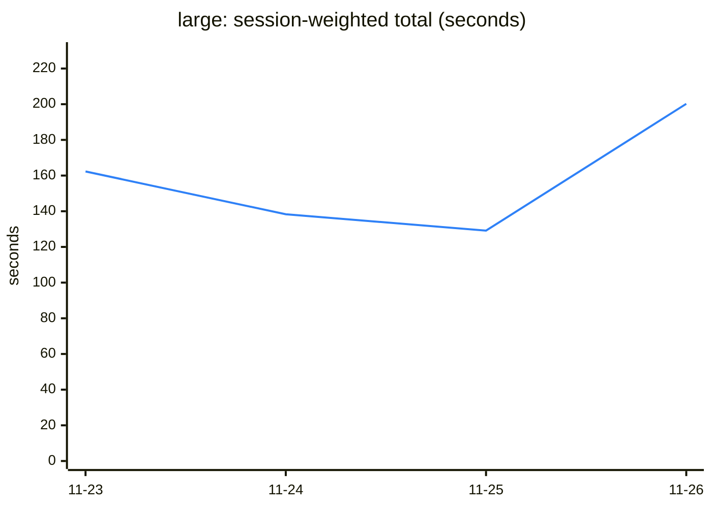
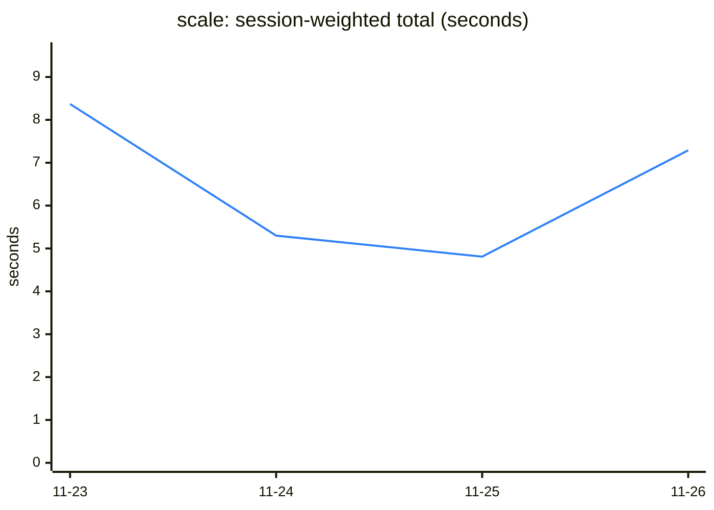
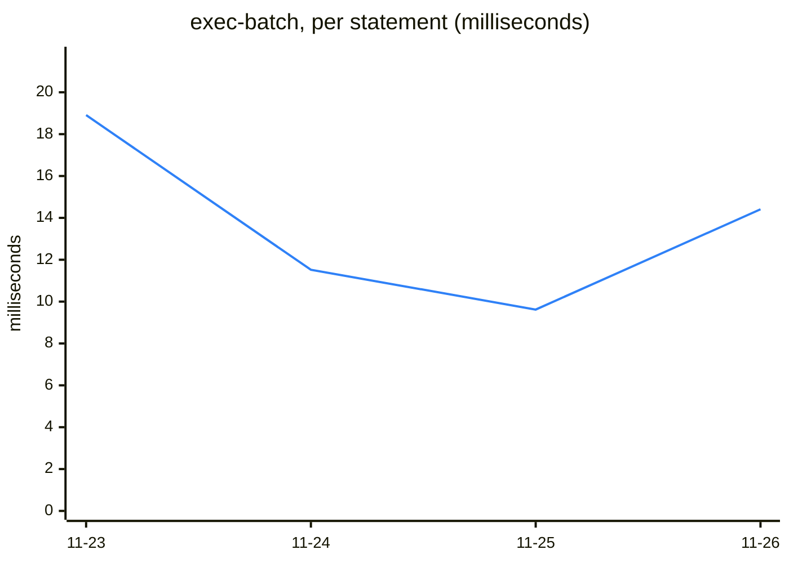
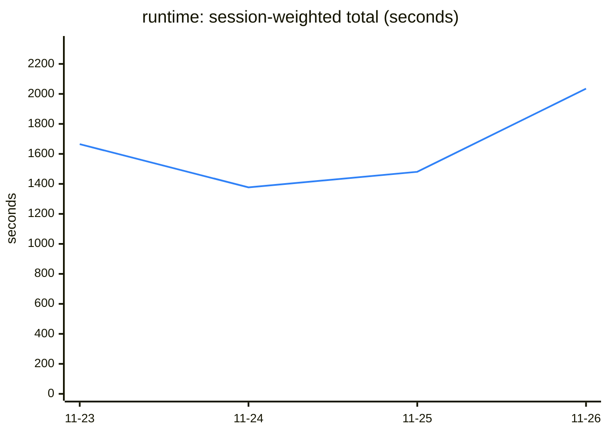

# Agent dev-loop benchmark — trend

4 runs, 2026-11-23 to 2026-11-26. Latest: `mxcli version 997c721 (2026-11-26T10:30:19Z)` against `mxcli version nightly-20261124-997c721f6 (2026-11-24T12:56:37Z)`.

Generated by `scripts/agentbench/trend` after each run; do not edit. Times are the candidate's median wall time on that night's runner, so two nights differ by the machine as well as by the code: read a level that stays, not one night's step. How to read it: `docs-site/src/internals/agent-benchmark.md` on `main`.

## Alerts

None.

## small project — 370 units



| step | latest | run before | median of the 7 before | against that median | against its baseline, latest | last runs |
|---|---:|---:|---:|---:|---:|---|
| (session-weighted total) | 133.4 s | 90.0 s | 97.1 s | × 1.37 | × 1.00 | ▄▂▁█ |
| open-cold | 189 ms | 135 ms | 179 ms | × 1.06 | × 0.97 | █▆▁▇ |
| open | 69 ms | 43 ms | 55 ms | × 1.25 | × 0.98 | ▄▄▁█ |
| domain | 915 ms | 609 ms | 609 ms | × 1.50 | × 1.01 | ▄▁▁█ |
| microflows | 654 ms | 419 ms | 495 ms | × 1.32 | × 1.00 | █▂▁▄ |
| pages | 2.07 s | 1.43 s | 1.47 s | × 1.40 | × 1.01 | █▁▁▇ |
| describe | 157 ms | 105 ms | 117 ms | × 1.34 | × 0.98 | ▄▂▁█ |
| catalog | 287 ms | 172 ms | 184 ms | × 1.56 | × 0.99 | ▄▁▁█ |
| catalog-full | 1.45 s | 920 ms | 920 ms | × 1.58 | × 0.99 | ▃▁▁█ |
| query | 96 ms | 63 ms | 73 ms | × 1.31 | × 0.98 | ▅▃▁█ |
| check | 428 ms | 296 ms | 308 ms | × 1.39 | × 0.99 | ▄▁▁█ |
| single-edit | 447 ms | 301 ms | 325 ms | × 1.38 | × 1.01 | ▄▂▁█ |
| catalog-after-edit | 281 ms | 176 ms | 211 ms | × 1.33 | × 0.99 | █▃▁█ |
| bulk-alter | 1.43 s | 978 ms | 1.12 s | × 1.27 | × 1.00 | █▃▁█ |
| re-exec | 745 ms | 521 ms | 523 ms | × 1.42 | × 0.99 | ▃▁▁█ |
| rename | 646 ms | 426 ms | 426 ms | × 1.52 | × 1.00 | █▁▁▇ |

## large project — 910 units



| step | latest | run before | median of the 7 before | against that median | against its baseline, latest | last runs |
|---|---:|---:|---:|---:|---:|---|
| (session-weighted total) | 200.2 s | 129.2 s | 138.3 s | × 1.45 | × 1.01 | ▄▂▁█ |
| open-cold | 362 ms | 256 ms | 322 ms | × 1.12 | × 1.04 | █▅▁█ |
| open | 85 ms | 56 ms | 63 ms | × 1.34 | × 0.97 | ▄▂▁█ |
| domain | 1.05 s | 707 ms | 746 ms | × 1.41 | × 1.00 | ▄▁▁█ |
| microflows | 1.64 s | 928 ms | 1.14 s | × 1.44 | × 1.00 | ▆▃▁█ |
| pages | 2.57 s | 1.70 s | 1.84 s | × 1.40 | × 1.00 | █▂▁█ |
| describe | 189 ms | 125 ms | 134 ms | × 1.41 | × 0.99 | ▄▂▁█ |
| catalog | 433 ms | 260 ms | 285 ms | × 1.52 | × 0.99 | ▆▂▁█ |
| catalog-full | 4.60 s | 2.90 s | 2.90 s | × 1.59 | × 1.00 | ▃▁▁█ |
| query | 98 ms | 68 ms | 77 ms | × 1.27 | × 0.97 | ▅▃▁█ |
| check | 669 ms | 437 ms | 463 ms | × 1.45 | × 0.99 | ▄▁▁█ |
| single-edit | 673 ms | 430 ms | 459 ms | × 1.47 | × 1.01 | ▄▁▁█ |
| catalog-after-edit | 413 ms | 262 ms | 317 ms | × 1.30 | × 0.99 | ▇▃▁█ |
| bulk-alter | 1.77 s | 1.19 s | 1.34 s | × 1.32 | × 1.01 | ▆▃▁█ |
| re-exec | 1.05 s | 690 ms | 730 ms | × 1.43 | × 1.01 | ▄▁▁█ |
| rename | 1.27 s | 811 ms | 811 ms | × 1.56 | × 1.00 | ▄▁▁█ |

## scale project — 4374 units



```mermaid
---
config:
  themeVariables:
    xyChart:
      plotColorPalette: "#2f81f7"
---
xychart-beta
    title "check-one (seconds)"
    x-axis ["11-23", "11-24", "11-25", "11-26"]
    y-axis "seconds" 0 --> 0.87
    line [0.60, 0.50, 0.48, 0.75]
```



| step | latest | run before | median of the 7 before | against that median | against its baseline, latest | last runs |
|---|---:|---:|---:|---:|---:|---|
| (session-weighted total) | 7.29 s | 4.81 s | 5.30 s | × 1.38 | × 0.99 | █▂▁▆ |
| check-cold | 1.97 s | 1.32 s | 1.46 s | × 1.35 | × 0.98 | █▂▁█ |
| check-one | 754 ms | 482 ms | 498 ms | × 1.51 | × 1.00 | ▄▁▁█ |
| check-batch | 1.36 s | 905 ms | 905 ms | × 1.51 | × 1.01 | ▄▁▁█ |
| exec-batch | 1.44 s | 962 ms | 1.15 s | × 1.25 | × 1.00 | █▂▁▅ |
| re-exec-batch | 780 ms | 527 ms | 545 ms | × 1.43 | × 1.00 | ▆▁▁█ |
| new-batch | 981 ms | 623 ms | 777 ms | × 1.26 | × 0.98 | █▁▁▃ |

## running app — 476 units



| step | latest | run before | median of the 7 before | against that median | against its baseline, latest | last runs |
|---|---:|---:|---:|---:|---:|---|
| (session-weighted total) | 2034.9 s | 1480.6 s | 1480.6 s | × 1.37 | × 1.00 | ▄▁▂█ |
| mx-check | 8.53 s | 5.61 s | 5.61 s | × 1.52 | × 1.02 | ▄▁▃█ |
| build | 58.5 s | 42.4 s | 43.9 s | × 1.33 | × 1.00 | ▅▁▁█ |
| boot | 30.1 s | 22.3 s | 22.3 s | × 1.35 | × 1.03 | ▄▁▂█ |
| page-check | 3.29 s | 2.46 s | 2.49 s | × 1.32 | × 0.97 | ▅▁▁█ |
| hot-apply | 5.53 s | 4.36 s | 4.36 s | × 1.27 | × 0.95 | ▃▁▁█ |
| test-attach | 137 ms | 100 ms | 104 ms | × 1.32 | × 0.95 | ▄▁▁█ |
| apply-entity | 18.2 s | 14.3 s | 14.3 s | × 1.27 | × 0.98 | ▅▁▁█ |
| stop | 842 ms | 629 ms | 730 ms | × 1.15 | × 1.00 | ▄▄▁█ |
| test-cold | 25.4 s | 18.7 s | 18.7 s | × 1.36 | × 1.01 | ▄▁▁█ |
